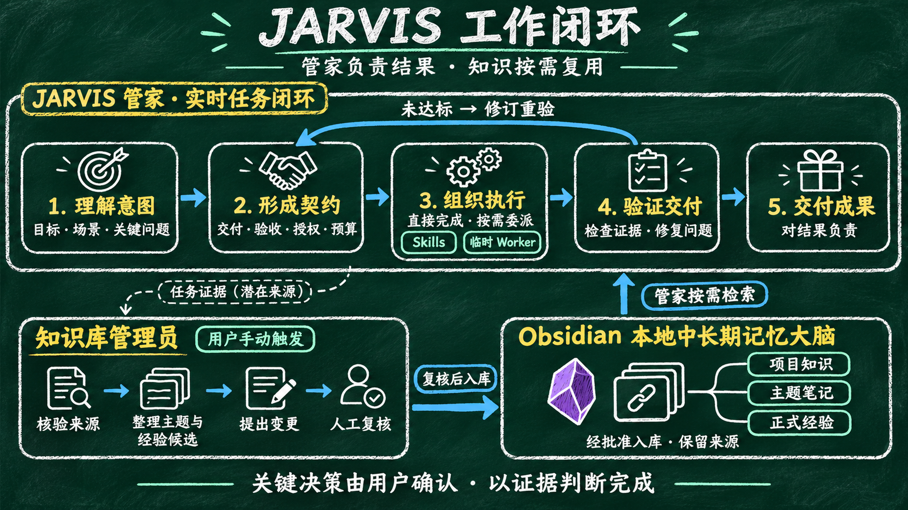

# JARVIS

**理解意图，组织执行，对结果负责。**

## 你好，我是 JARVIS

嗨，我是 JARVIS！名字是跟《钢铁侠》里托尼的管家借的。我也想像他一样，陪你在工作台前捣鼓点东西。有点子就说，没想全也行，咱们边做边想。我哪儿做得不对，你就直说，我下回争取做得好一点。

JARVIS 是一套运行在 Codex 项目主会话中的个人 AI 管家协作方案。它将任务契约、按需委派、证据验证与本地知识积累连接起来，帮助用户把一个想法推进为可检查、可交付的成果。

Obsidian 承担本地中长期记忆大脑：保存项目知识、主题笔记和经过复核的经验，由管家在需要时检索，再为当前任务提供上下文。



当前发布版本：**V1.4.6**（2026-11-26）。版本信息见 [发布规则](docs/rules/release.md)。

## 快速试跑

克隆仓库，在 Codex 中打开项目根目录。用下面这条消息试跑一次带检查点的任务。

> JARVIS，请做一次只读的 README 链接检查。先给出任务 ID、验收条件和步骤，等我复核。把本地文件链接和章节锚点分成两步检查，每步保存验证结果。在第一步完成后停在检查点，等我从原任务继续。

复核后运行第一步，再回到任务的专属会话继续。

> JARVIS，恢复任务 <task_id>。请从检查点继续，交付时列出两步的验证结果和证据位置。

实际应用中，Brain v1 用同样的方式保留了迁移基线、验证结果和恢复位置。项目还用隔离库和活动库检查了初始化、链接与核心属性。[Brain v1 初始化验证](docs/releases/V1.2.4.md)

完成试跑后，可接入 Obsidian 保存经复核的任务总结，并用它生成日报和周报。[开始使用](#开始使用) · [生成日报与周报](docs/environment.md#生成日报与周报)

## 人格表达与自动适配

提供沉稳管家、热情好事、专业干练、好奇话痨、激进大胆五套可替换表达模块。新环境默认选用沉稳管家，可在本机通过 `persona.module` 指定模块，或设为 `auto` 自动匹配。本机 `.local/environment.json` 的 `persona.enabled` 统一启用/关闭；关闭后恢复基础 JARVIS，身份与任务规则继续有效。新环境默认启用，旧配置缺字段保守关闭。[使用与设计](docs/persona.md) · [行为示例](docs/persona-examples.md)

## 为什么做 JARVIS

复杂任务往往跨越多轮对话、多个工具和不同执行者。JARVIS 用明确的目标、职责和交付证据保持任务连续性，让当前工作能够完成，也让有价值的知识在后续工作中得到复用。

- **从意图开始**：明确要解决的问题、使用场景和预期结果，先处理会影响执行的关键缺口。
- **让完成有依据**：将交付物与验收标准对应，检查实际证据，未达标时修订并重验。
- **按需组织能力**：明确执行任务默认留卡并完整闭环，按复杂度简写，授权范围内连续执行和修复；随交付准备三层本地笔记及风险建议供人工复核，正式写库另批。需要时调用真实可用的 Skill 或临时 Worker。
- **让知识可追溯**：保留来源、决策和验证边界，经复核后再沉淀为可复用知识。

## 角色与分工

| 组成 | 主要职责 | 协作方式 |
| --- | --- | --- |
| **JARVIS 管家 Agent** | 理解意图，维护任务契约、上下文、依赖与状态，组织执行，整合和复核结果 | 项目主会话入口，对整体目标与最终交付负责 |
| **临时 Worker** | 在指定工作包内执行、验证并返回产物和证据 | 管家按需创建与派发，完成后复核并收尾 |
| **Skills** | 提供可复用的方法、工具使用规则和专业流程 | 管家或 Worker 按任务选择，并读取实际指令 |
| **知识库管理员 Agent** | 核验来源，按主题整理知识，提炼经验候选，检查重复、冲突与过期内容，提出变更及 Skill 映射 | 用户手动触发的离线角色，候选经人工复核后才能正式入库 |
| **Obsidian 本地知识库** | 持久保存项目知识、主题笔记、正式经验及其来源和关联 | 管家按需检索，为后续任务补充中长期记忆 |

## 任务怎样形成闭环

1. **理解意图**：明确目标、场景、约束与关键问题。
2. **形成契约**：约定交付物、验收证据、授权范围和执行预算。
3. **组织执行**：选择直接完成、调用 Skill 或按需委派；持续维护任务状态。
4. **验证交付**：检查产物与证据，修复问题；要求变化时修订契约并重验受影响结果。
5. **交付成果**：说明实际完成内容、验证结果和待决事项，保留续作检查点。

实质任务先提交简单／中等／复杂的判断及理由、闭环方式和契约摘要，经用户复核后执行。简单任务使用轻量契约，复杂任务使用带修订号任务卡；是否委派按收益另行判断。已复核范围内的执行、检查与修复连续推进。分类依据和例外见 [任务分类与事前复核规则](AGENTS.md)。

已批准的多步本地任务可采用 [长路径执行模式](docs/task-loop.md)。JARVIS 连续执行和修复，本地运行器记录每次尝试、验收证据和续作位置。

## Obsidian Brain v1

本地增量能力 **Brain V1.1：LLM Wiki** 提供来源版本登记、由活动模型生成的证据主题候选、差异预览、基线保护应用及来源变化复审。[使用、架构与能力对照](docs/brain-wiki.md)。新综合保持 review，人工验收与技术自检分开；Brain 能力版本独立于项目发布号。

Brain v1 是 JARVIS 的本地长期记忆。Markdown 正文与扁平属性（frontmatter）保存笔记、来源、状态和复审日期。Obsidian 提供浏览与编辑界面，首页、主题索引和 Bases 帮助定位同一批笔记。当前会话处理即时上下文，JARVIS 按任务需要检索跨会话知识。

### 怎样工作

1. **按需检索。** JARVIS 从当前任务的问题出发，查找相关任务总结、规则、主题笔记和参考资料，再回读原文。
2. **核对证据。** 检查来源、时间、适用条件和冲突，再把结论用于当前决策或交付。证据不足时明确说明。
3. **整理入库。** 用户指定整理范围后，知识库管理员核验来源，形成候选和变更提案，经人工复核后按批准差异写入。人工编辑发生冲突或写入基线变化时，暂停受影响的批次。
4. **复审和维护。** 按运行规程执行健康检查，发现断链、核心属性缺失、复审过期、缺少来源和证据以及缺少替代目标等问题。维护活动及证据记入 Brain 运行日志。

新材料从 `inbox` 进入 `review`，待来源或决策依据明确、适用范围清楚并满足相应复核要求后成为 `active`。知识被替代或退役后，标记为 `superseded` 或 `archived`。正式规则、经验和跨来源综合的生效由用户复核。检索与整理随任务和用户触发运行。

| 知识库目录 | 保存什么 |
| --- | --- |
| `01 草稿` | 新材料、待复核笔记和迁移候选 |
| `02 工作记录` | 任务总结、按需生成的日报和周报、Brain 运行日志 |
| `03 wiki` | 主题、参考资料、逐条链接来源的综合笔记，以及索引和视图 |
| `04 模板` | 标记为 `type: template` 的笔记模板 |
| `05 规则` | 运行规程、治理规则和决策记录 |
| `06 归档` | 可回读的历史业务对话 |
| `99 附件` | 笔记引用的附件 |

使用步骤见文档中的 [任务知识应用](docs/task-knowledge.md) 和 [知识库初始化](docs/environment.md#知识库目录与模板已提供初始化入口)。

### 四个 Obsidian Bases

| 视图 | 用途 |
| --- | --- |
| 待复核 | 集中查看状态为 `review` 的待复核笔记 |
| 需要复审 | 找出复审日期已过的 `active` 笔记 |
| 主题地图 | 按主题分组浏览笔记及其状态 |
| 证据缺口 | 查看可信度为 `unknown` 的 `active` 笔记，便于检查其中的来源和证据 |

### 能发挥什么作用

- **跨会话续作。** JARVIS 从任务卡和检查点定位进度，用 Brain 中的任务总结、历史决策和证据补齐上下文。
- **复用项目经验。** 遇到相似任务时，找回已经验证的方法、适用条件和失败记录，并核对本次是否适用。
- **提供有依据的回答。** 回读原文后引用来源，说明结论适用的时间和范围，保留互相冲突的证据供复核。
- **维护现行知识。** 通过 Bases 发现待复核和过期内容，通过健康检查发现结构问题，并用替代关系保留决策沿革。

### 验证状态

四个 Bases 已在 Obsidian 1.15.1 中验证渲染和交互。当前 JARVIS 的 35 题问答基线通过了确定性的引用、要点及拒答检查。独立外部模型评测、人工盲评和跨设备同步仍待验证。

## 开始使用

### 1. 下载项目并启动激活引导
最简单的方式是先在codex里创建一个空的project，指向本地一个空的目录，然后在该project里发起一次对话，输入如下提示词
```text
从https://github.com/wang123good/jarvis，下载jarvis项目到本地，然后激活 JARVIS：请先完整读取当前项目根目录的 AGENTS.md，执行其中的初始化状态检查，并按 docs/onboarding.md 启动或续接激活引导。
```

需要 Windows、Git、Python，以及能够读取项目指令和本地文件的 Codex 环境。首次引导会检查 Obsidian；缺少软件时会说明并等待具体安装授权，不会自动安装。使用临时 Worker 时，宿主还需提供相应 Agent 工具。详见 [环境说明](docs/environment.md)。

在 Codex 中打开用于存放项目的本地目录，发送以下提示词即可开始。如果当前目录已有其他项目，请明确指定一个新的下载目录。

```text
从 https://github.com/wang123good/jarvis，下载 jarvis 项目到本地，然后激活 JARVIS：请先完整读取当前项目根目录的 AGENTS.md，执行其中的初始化状态检查，并按 docs/onboarding.md 启动或续接激活引导。
```

也可以手动下载，再在 Codex 中打开克隆后的项目根目录：

```powershell
git clone https://github.com/wang123good/jarvis.git
cd jarvis
```

已有本地项目时，发送下面这条消息即可启动或继续引导：

```text
激活 JARVIS：请先完整读取当前项目根目录的 AGENTS.md，执行其中的初始化状态检查，并按 docs/onboarding.md 启动或续接激活引导。
```

### 2. 跟随引导完成初始化

| 步骤 | JARVIS 会做什么 | 你需要做什么 |
| --- | --- | --- |
| 初始化检查 | 读取激活状态、画像状态及人格配置；已激活则直接进入正常服务 | 等待检查结果 |
| 设置称呼 | 首次询问昵称，并将已确认称呼保存在本地 `up.json` | 回复希望使用的称呼，或回复“跳过” |
| 选择知识库 | 展示已有库的名称、完整路径和来源，提供新建及自定义位置；推荐空闲空间最大的可用固定盘 | 选择已有库，或提供完整路径，例如 `D:\个人知识库-X` |
| 预览并批准 | 检查目标，列出待新增目录、文件、当前实例配置及项目登记范围 | 核对具体预览后回复“批准”；仅选择位置不会触发库内容写入 |
| 准备和验证 | 按批准范围补齐缺项、保存当前实例配置，核验项目目录、共享层和 Router 检索原文 | 若检查失败，按提示处理阻塞项；已有同名文件会保留 |
| 自动激活 | 同一轮再次核验目标与原文，保存并回读激活状态，展示使用说明并接回原请求 | 无需回复随机码；看到 `activated` 即表示本地激活完成 |

例如：首次回复你的昵称；选库时回复 `D:\个人知识库-X`；看到具体改动预览后回复“批准”。JARVIS 随后完成准备、验证和激活。这个路径仅为示例，每个副本独立选库。

激活表示本地技术检查通过。使用说明由当前对话展示，激活记录不表示用户已阅读或理解。Obsidian GUI 安装检测与 CLI 检查分别报告；CLI 不在 PATH 中不妨碍独立文件入口。

引导中断后，在同一项目重新发送“激活 JARVIS”及上述读取指令即可按本地检查点续接。若曾明确暂停，请说“继续激活引导”；若原聊天不可读取，补充原始请求。旧版停在随机码回执步骤的实例会按新版规程复验并激活，已有激活记录继续有效。完整规程见 [首次对话引导](docs/onboarding.md)。

### 本机配置与手动维护

正常首次使用由上述引导创建配置，无需再手动执行 setup。每个 JARVIS 副本在自己的 `.local/environment.json` 保存知识库和连接器设置。需要手动维护时，以下命令仅配置当前副本的库路径，不能代替完整激活引导：

```powershell
python -X utf8 scripts/setup_environment.py --vault 'C:/path/to/your/vault'
```

已有旧配置先按实例预览和确认迁移。详细步骤见 [逐实例迁移](docs/environment.md#逐实例迁移)。

共享配置分工：

- [知识库入口](.codex/obsidian-kb.json)：本机配置引用、项目相对目录与知识分层。
- [默认配置](config/defaults.json)：项目相对资源、库内注册表相对路径与执行护栏；项目根和 Skill 根由解析器确定。
- [项目协作画像说明](docs/user-profile.md)：已批准条目的项目范围、来源及读取条件。
- [知识库管理员指令](agents/knowledge-administrator.md)：本机实际可用的来源导出和知识整理工具。

这些配置需要与本机文件和工具一致。用户画像独立保存在项目根目录 `up.json`，首次使用由 JARVIS 询问昵称后创建，不依赖 Obsidian 路径；用户可跳过。公开仓库仅提供 [空白模板](up.example.json)，个人画像不提交 Git。明确要求记住的偏好可直接保存，观察候选需经确认后生效。

### 3. 在项目中提出任务

在 Codex 中打开仓库，由 [AGENTS.md](AGENTS.md) 提供管家入口，然后直接说明希望完成的工作，例如：

> JARVIS，请评审这份技术方案，给出实施建议、验证方法和仍需确认的问题。

> JARVIS，请将这个需求推进为可交付成果，需要时按工作包委派，并在交付前检查证据。

需要整理知识时，单独明确触发：

> 知识库管理员，请整理当前任务的方案决策与验证结论，按主题生成候选草稿，先供我复核。

### 4. 检查资源与接入

完成本机路径与工具配置后，可在仓库根目录运行：

```bash
python scripts/verify_installation.py --environment-only
```

先配置当前实例的目标库，再运行上述环境检查；脚本为每次运行生成独立证据目录。省略 `--environment-only` 才检查真实注册表及限定检索，另需支持显式 `--config` 的外部 Skill。环境检查不冒充完整接入验证。

源码、角色、模板和文档保留在仓库；任务附件、运行证据和个人画像仅在本地保存。历史文件已迁至库外，位置及路径映射见 [归档索引](docs/archive-index.md)。

## 参与和许可

欢迎通过 Issue 分享使用问题、验证结果和改进建议。提交变更时，请保留可复现的验证命令和仍未验证的边界。

本项目采用 [MIT License](LICENSE)。

## 仓库导航

目录职责与后续扩展约定见 [目录说明](docs/directory-layout.md)。角色、配置、模板、脚本和测试分别位于 `agents/`、`config/`、`templates/`、`scripts/`、`tests/`；运行数据统一放在不提交 Git 的 `.local/`。

| 文件 / 目录 | 用途 |
| --- | --- |
| [AGENTS.md](AGENTS.md) | 管家身份、任务入口、协作与权限规则 |
| [docs/operations.md](docs/operations.md) | 当前实现的使用说明 |
| [config/defaults.json](config/defaults.json) | 执行模式与软默认值 |
| [templates/task.md](templates/task.md) | 任务契约、检查点和验收记录模板 |
| [agents/worker.md](agents/worker.md) | 临时 Worker 角色与派发规程 |
| [templates/worker-work-package.md](templates/worker-work-package.md) | 委派目标、上下文、范围、预算和返回要求 |
| [agents/knowledge-administrator.md](agents/knowledge-administrator.md) | 知识库管理员的整理与批准变更流程 |
| [templates/knowledge-run-request.json](templates/knowledge-run-request.json) | 一次知识整理的来源、目标与授权范围 |
| [docs/user-profile.md](docs/user-profile.md) | 项目协作画像的读取、复核与版本规则 |
| [.codex/obsidian-kb.json](.codex/obsidian-kb.json) | 共享知识层级与本机配置引用 |
| [config/environment.example.json](config/environment.example.json) | 本机环境空白示例；实际 `.local/environment.json` 不提交 |
| [scripts/resolve_environment.py](scripts/resolve_environment.py) | 实例配置解析与写前一致性检查 |
| [架构方案](%E6%9E%B6%E6%9E%84%E6%96%B9%E6%A1%88/) | 架构设计与角色职责文档 |

## 当前实现与验证边界

当前版本为 **v0.1**，采用项目主会话、角色指令、模板与本地文件组织协作。临时 Worker 和知识库管理员依赖宿主实际提供的工具按需运行。

执行预算、重试上限和协作范围目前属于指令约定。硬预算控制、Worker 系统级访问隔离、常驻服务、自动跨会话学习，以及知识整理的完整恢复能力，均需另行实现和验证。

日报与周报支持按需预览并写入 Obsidian，见 [生成日报与周报](docs/environment.md#生成日报与周报)。
