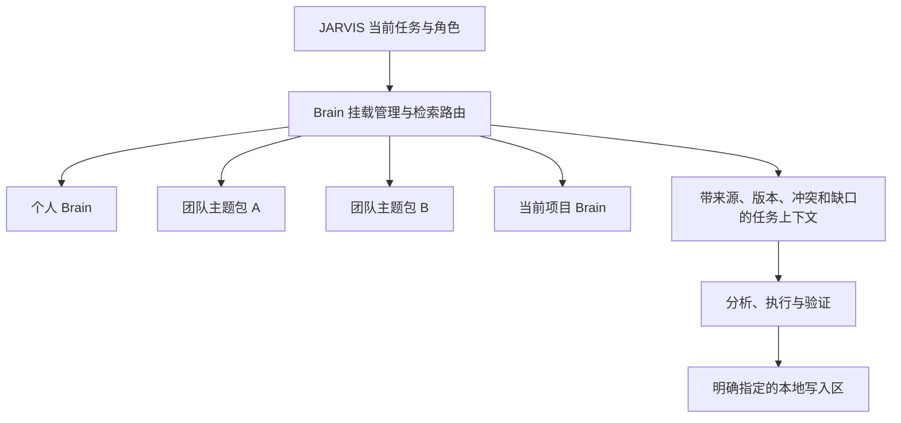

# JARVIS Brain 模块化、共享与热插拔需求规划

- 记录日期：2026-11-25
- 需求编号：BRAIN-MOD-001
- 状态：讨论留存，待后续统筹评估是否启动实现
- 来源：当前 Brain 设计讨论；用户提出不同岗位的 Brain 差异、团队主题知识共享、方向交叉研究和本地多库按需挂载，并要求“把我们的讨论总结到架构与需求规划里，待后续统筹考虑是否启动实现”。
- 授权边界：本次仅整理项目架构文档。以下架构、阶段和验收均为候选，未批准技术选型、开发、安装、切库、知识迁移、团队分发或 GitHub 发布；无执行排期及后台跟进。
- 关联规划：[BRAIN-API-001：统一接口与 MCP](./JARVIS%20Brain%20统一接口与MCP需求规划.md)。两个需求可统筹评估，均未启动实现。

## 用户场景与明确需求

1. **岗位差异。** 图像算法预研人员与负责算法在型号机上工程交付的人员，其 JARVIS 所需知识结构和功能侧重不同。
2. **团队共享。** 不同角色、不同算法方向的成员需要共享选定主题的体系知识，使本地 JARVIS 能快速获得该领域的知识和开展工作的能力。
3. **交叉研究。** 本地 JARVIS 需要组合多个方向的知识，支持交叉融合性质的研究。
4. **可热插拔。** 本地可以保存多个知识库副本，由用户按需要求 JARVIS 挂载不同 Brain，使用不同记忆。
5. **企业信息边界。** 知识库及真实业务内容不得同步发布到 GitHub。通用规则、脚本、Skill、模板和环境说明等项目文件仍须经过内容审查及对应发布授权。

用户批准的是保留本轮讨论；下文对模块、角色、共享流程和实现顺序的划分属于 JARVIS 建议，不代表用户已经选定全部设计。

## 设计方向：统一底座，按角色、领域和项目组合

建议保留统一的知识身份、版本、来源、状态和访问规则，允许不同内容结构通过明确映射接入，不要求所有成员重建完全相同的目录。

> 个人 Brain 使用组合 = 私有记忆 + 角色配置 + 领域知识模块 + 当前项目知识。

| 组成 | 保存或控制什么 | 组合边界 |
| --- | --- | --- |
| 私有记忆 | 个人任务经验、历史决策和个人笔记 | 默认本地私有，不随主题共享导出 |
| 角色配置 | 问题组织方式、工作流程、证据要求、常见交付物 | 可按任务切换；不修改 JARVIS 身份、宿主权限或用户画像 |
| 领域模块 | 算法概念、方法、适用条件、反例和评测体系 | 可供多个岗位复用，不强制复制整个人库 |
| 项目模块 | 具体实验、型号、平台、版本和交付约束 | 保持项目边界，仅在明确范围内参与检索 |
| 任务研究空间 | 本次分析、实验、跨领域假设及新证据 | 新结论先待复核，再提议更新个人或团队知识 |

| 关注点 | 图像算法预研角色示例 | 型号机工程交付角色示例 |
| --- | --- | --- |
| 工作主线 | 问题定义、方法探索、实验与归因 | 集成适配、性能优化、问题定位与验收 |
| 关键知识 | 原理、论文、假设、实验设计、失败案例 | 平台约束、接口、兼容性、部署与回归经验 |
| 证据重点 | 数据条件、对照实验、适用范围 | 设备环境、算法版本、日志、测试及交付基线 |
| 常见产出 | 预研报告、原型、实验结论 | 集成方案、问题闭环、版本交付记录 |

示例：两个岗位共用“图像降噪”主题包，分别搭配预研角色或交付角色；交叉研究时追加“运动估计”等主题包。以上仅说明结构，不引用真实企业项目或业务数据。

## 主题知识包与技能边界

建议同时支持完整 Brain 挂载和独立主题知识包。主题包应能脱离个人库被理解和检索，提供主题地图、术语、原理与方法、工程经验、失败条件、来源、操作流程或技能引用以及评测案例。

候选清单至少声明：稳定 ID、版本、内容指纹、维护者、适用范围、依赖、复核状态、共享范围及兼容要求。本机路径另存在本地注册表，不写入共享包或个人画像。

知识与执行能力分别声明和验收：

- **知识就绪**：主题结构、原文、引用和依赖可用，能在范围内检索。
- **技能就绪**：关联的真实 Skill、脚本、工具和环境可用，并通过适用案例验证。
- 挂载知识包不自动安装、执行或批准其中的代码、Skill 和规则；笔记正文不能授予动作权限。
- 获得资料不等于模型权重发生学习，也不保证具备该领域的完整专业能力。

## 候选架构与挂载语义

建议支持两种模式：**切换**改变后续可用的 Brain 范围；**组合**在一个明确任务范围内联合检索多个 Brain 或主题包。挂载不等于全量注入上下文，仍按问题检索和回读原文。

| 编号 | 候选需求 | 行为及后续验收方向 |
| --- | --- | --- |
| R01 | 本机注册与明确选择 | 使用 Brain ID 或别名定位已确认目录；不扫描磁盘猜测目标，不借挂载扩大授权 |
| R02 | 预检查与安全生效 | 检查结构、版本、依赖、范围和索引；失败保留原状态，不留下半生效挂载 |
| R03 | 多库联合检索 | 查询、原文读取、附件和链接扩展均遵循本次允许范围；结果保留 Brain、包、项目及版本来源 |
| R04 | 任务版本固定 | 记录挂载组合及内容版本；任务中升级需显式处理，不能静默改变证据基线 |
| R05 | 副本与分支身份 | 区分同一包的不同版本、本地副本和个人分支；副本不能计为独立证据，来源更新后能定位受影响结论 |
| R06 | 跨包稳定引用 | 引用由包 ID、笔记 ID 和版本等信息定位；缺失依赖明确报告，不用相似标题静默替代 |
| R07 | 受控写入 | 建议共享包默认只读，每个任务明确一个写入目标；写前预览、授权、基线核对和回读，切库使旧预览失效 |
| R08 | 卸载与上下文边界 | 卸载停止后续检索，并使相关检索缓存及运行指针失效；已进入聊天的内容不能靠卸载自动消除。严格隔离使用新聊天并控制交接内容 |
| R09 | 角色组合 | 角色改变工作方法与证据要求，不自动扩大知识访问；可在同一领域知识上切换岗位视角 |
| R10 | 知识与技能分离 | 分别显示知识可用、技能缺失、依赖未满足和验证状态；知识挂载不自动启用长期能力 |
| R11 | 冲突与可信度 | 默认排除非现行内容；保留冲突和证据缺口，不按库顺序、文件新旧或角色静默裁决语义矛盾 |
| R12 | 共享与衍生追溯 | 导出包检查正文、附件、链接和来源依赖；衍生综合保留来源及共享限制，不因综合自动扩大可传播范围 |

上述约束需要在实际访问路径执行并验证；只写清单、提示词或角色约定不等于强制隔离。技术上的本机访问权限也不等于团队传播授权。

## 团队共享与本地演进

建议先采用受控版本分发和本地覆盖，实时多人同步或协同编辑另行评估：

> 个人任务证据 → 主题候选 → 来源与共享范围复核 → 团队版本 → 成员本地挂载 → 新任务反馈。

- 团队包由指定维护者管理；成员在本地覆盖层保留注释、实验和修订建议，不直接改写团队原版。
- 更新时显示变更及本地覆盖冲突，保留旧版本供任务追溯；离线副本的时效和撤回处理需单独设计，不能承诺远程消除已复制内容。
- 可信状态与共享范围独立管理：已验证知识可能仅限一个项目，共享材料也可能仍是待验证假设。
- 跨领域结论先作为待验证假设，经过本地实验和人工复核再提议升级为正式知识。
- 企业知识包使用受控内部渠道；GitHub 仅可承载经审查和授权的通用管理代码、格式、规则、模板及无敏感信息的示例。知识库、个人画像、运行记录和真实业务样本不得随包管理代码上传。

## 当前实现与预期差距

截至本次讨论，现有入口通过 `JARVIS_VAULT_ROOT` 选择一个目标库，`scripts/resolve_environment.py` 校验环境；`scripts/brain_router.py` 提供单库内项目范围与共享层的只读检索；Brain V1.1 的 `scripts/brain_wiki.py` 提供来源版本、综合候选、差异与受控应用流程。

这些是候选方案可复用的基础，不能视为已实现多库联合挂载、主题包版本分发、跨包稳定引用、角色组合或团队权限管理。当前解析环境不检查 Obsidian GUI 的切库行为，多库文件访问和 GUI 浏览的关系也需后续评估。

未来候选组件包括本机挂载注册、知识包清单、跨库检索路由、任务挂载快照及包导入导出；其文件名、格式和实现位置尚未选定。角色配置与现有人格表达模块职责不同，不能用人格模块替代专业工作流程。

## 分阶段建议与统筹决策

| 候选阶段 | 范围 | 验收重点 |
| --- | --- | --- |
| 第一阶段：可插拔 | Brain 身份、版本、本机注册和安全切库 | 目标正确、失败不误切、写入不串库、旧指针与预览失效 |
| 第二阶段：可组合 | 多库只读挂载、跨包引用、角色配置及任务快照 | 多源可区分、副本不重复计证、冲突可见、版本可追溯 |
| 第三阶段：可共享 | 主题包发布、更新、本地覆盖、技能关联和评测 | 另一位成员能复用知识与方法，缺失依赖和传播范围可检查 |

建议用“两个岗位共用一个算法主题包，各自完成岗位判断，再追加第二领域开展一次交叉研究”作为验证场景，在隔离样本中与现有单库方式对比。评价应覆盖引用正确性、适用条件、方法可执行性、范围隔离和维护成本；不能仅以检索命中或成功挂载验收，也不预先承诺准确率或 Token 节省。

后续需统筹决定：

1. 首个真实试点及愿意维护主题包的角色；哪些内容允许共享，采用什么内部渠道。
2. 先做整库切换还是优先解决多主题组合，保留哪些现有目录及工具。
3. 角色配置、知识包、Skill 与本地覆盖的最小边界，版本兼容和更新责任。
4. 是否确有第二客户端需求，需要与 BRAIN-API-001 合并实施还是分别推进。
5. 开发范围、预算、验收证据和回退方案；由用户明确决定是否启动。

应先确定知识身份、组合、引用和写入语义，再评估 CLI、MCP 或其他接入形式。可插拔设计不以先实现 MCP 为前提，本次不重启已暂缓的 MCP 需求。

## 本次留存范围

本次只将当前聊天的需求和候选设计保存到项目架构目录，并补充目录入口及关联规划引用。未修改 Obsidian 知识库、运行配置、脚本或 Skill，未切换实际 Brain，未执行知识包分发或 GitHub 发布。后续以用户的统筹决定为启动依据。
