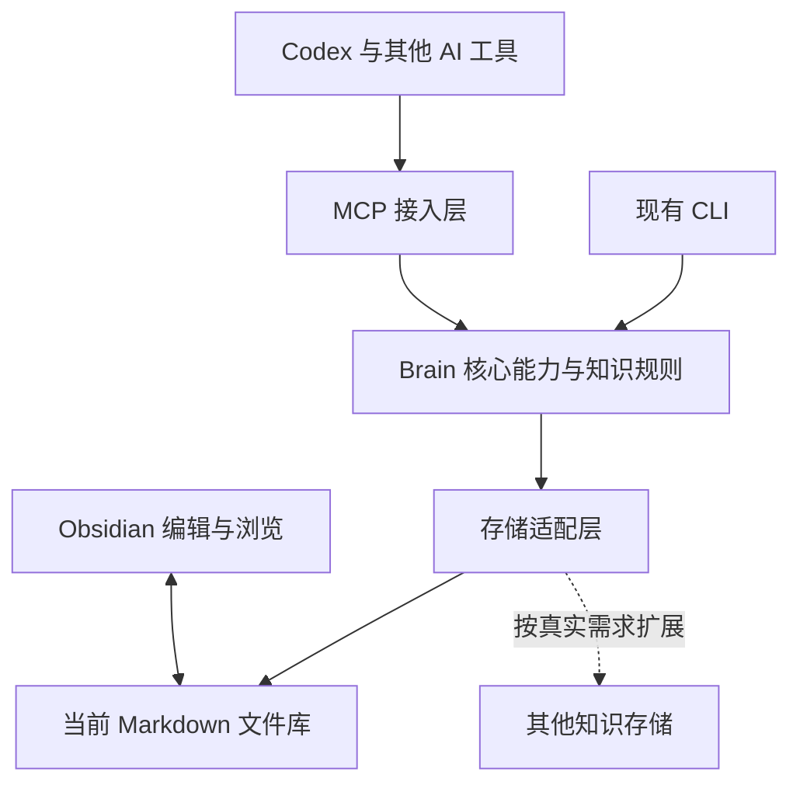

# JARVIS Brain 统一接口与 MCP 需求规划

- 记录日期：2026-11-25
- 需求编号：BRAIN-API-001
- 状态：暂缓，待用户重新决定是否启动
- 来源：本会话 Brain 跨工具接入与迁移调研；用户要求“整理到架构与需求规划里吧，先放一放”。
- 决策边界：批准保留规划，不代表批准技术选型、开发、安装、迁移或发布。无执行排期，不创建长时任务或后台跟进。

## 关联规划与统筹关系

同日补充 [BRAIN-MOD-001：Brain 模块化、共享与热插拔需求规划](./JARVIS%20Brain%20模块化共享与热插拔需求规划.md)，记录不同岗位的知识与工作流程差异、团队主题包共享、交叉研究及本地多库挂载需求。该规划同样待统筹评估，未启动实现。

两者建议共用知识身份、版本、引用、访问范围和写入语义；MCP 是候选接入形式，多库挂载不以先实现 MCP 为前提。后续分别核对多库场景与第二客户端的真实需要，再决定合并或分期；本次关联不改变本需求的暂缓状态。

## 问题与目标

为不同 AI 工具使用同一份 JARVIS Brain 提供稳定接口，并为将来替换知识存储后端保留基础。统一知识语义、范围和治理，再将 MCP 作为一种接入方式。区分 AI 宿主更换、知识存储迁移和整个 JARVIS 迁移；本需求仅覆盖前两项中的知识访问部分。

## 当前基础与差距

当前知识正文为 Markdown；Obsidian 承担编辑与浏览。仓库脚本直接访问文件，读取不必依赖 Obsidian 应用在线。

- `scripts/brain_router.py` 已输出带 schema_version 的 Context Pack，包括项目、状态、来源、排除项、冲突及证据缺口；只读约束为 write_allowed=false。
- `scripts/brain_note.py` 已提供笔记预览、基线校验和排他创建，但不构成通用更新事务或跨工具授权服务。
- `scripts/resolve_environment.py` 通过 JARVIS_VAULT_ROOT 选择本机目标库；配置就绪不等于内容写入授权。
- 知识规则仍分布在脚本、配置和 Agent 指令中。当前不存在已验证的统一 Brain MCP 服务、通用存储适配层或跨客户端治理保证。

## 预期价值与不值得做的范围

| 方向 | 潜在价值 | 成立条件或限制 |
| --- | --- | --- |
| 多工具共用知识 | 减少宿主分别复制脚本和配置 | 至少有第二个真实客户端需求，并验证客户端兼容 |
| 统一知识治理 | 项目隔离、状态、引用及证据缺口保持一致 | 服务端真正执行校验；不能只依赖提示词或工具注解 |
| 替换存储后端 | 上层调用契约稳定，后端按需适配 | 保留正文、稳定标识、属性、链接、附件及来源语义 |
| 多工具写入 | 集中预览、冲突检测、授权及回读 | 后续单独设计，不因接通 MCP 自动开放写入 |
| 接口评测 | 同一组案例检查不同客户端和后端 | 验证内容与边界，不能只验证连接成功 |

仅包装旧 CLI、只为更换 Markdown 编辑器开发完整服务、希望 MCP 本身改善检索准确率、提前适配大量未知后端，以及维护两份独立知识副本，均可能投入大于收益。MCP 不替代检索算法、数据迁移、权限治理，也不自动迁移人格、任务卡、会话及宿主权限。

## 候选架构（未选定）

MCP 与 CLI 应复用核心能力，避免两套规则。目标库由服务端配置并校验，客户端调用使用稳定库或项目标识，不能将任意本机绝对路径当作授权。远程、多用户、认证和权限隔离另行评估，不假定本机环境变量足以支持这些场景。

## 需求候选

| 编号 | 候选需求 | 后续验收方向 |
| --- | --- | --- |
| R01 | 版本化接口和能力声明 | 客户端识别版本、后端及不支持的能力，禁止静默降级 |
| R02 | 只读健康检查、搜索、原文读取、任务上下文 | 保留项目边界、状态、来源、引用、冲突与证据缺口；原文和链接访问同样受范围限制 |
| R03 | 存储中立的标识与数据契约 | 明确 ID、路径、属性、正文、附件和链接映射；导入导出可核对 |
| R04 | 统一治理 | 默认排除非现行知识；跨项目范围明确；不把笔记正文视为动作授权 |
| R05 | 写入能力后置 | 单独评审预览、批准凭据、基线、并发冲突、回读及失败恢复 |
| R06 | 客户端与适配器一致性评测 | 同一问题的项目范围、状态和引用含义一致；不强求检索排序完全相同 |

首期范围建议为只读接口，优先本机接入。后续范围由真实场景和用户复核决定，不预先承诺全部实现。

## 调研候选与证据边界

| 候选 | 讨论中识别的用途 | 重启时需要核验 |
| --- | --- | --- |
| Basic Memory | Markdown 与 MCP 跨工具记忆；优先评估复用 | 当前版本、许可证、Codex 接入、中文检索、现有属性及项目治理兼容；与现有库共用文件的行为 |
| cyanheads/obsidian-mcp-server | Obsidian 搜索和笔记操作适配 | Local REST API 依赖、应用在线要求、范围与写入能力；不能直接视为中立 Brain 核心 |
| Notion MCP | 未来远程知识后端候选 | 当前工具范围、数据转换、附件与链接保留、权限及费用 |
| MCP Memory / Filesystem 参考服务 | 协议及基础操作参考 | 参考实现与生产能力边界；不直接等同 JARVIS 知识治理 |

2026-11-25 本机 Codex 市场配置盘点：识别 personal、openai-primary-runtime、openai-bundled、openai-api-curated 四个来源；精选目录快照含 65 个条目，包含 Notion、Google Drive、SharePoint 等相关工具，未发现 Basic Memory 或 Obsidian 专用条目。仅代表当时本机目录快照，不代表完整公共市场，也不代表以后仍相同。

上一轮讨论给出的外部产品能力属于文档调研线索；本次只整理讨论，不新增核验。未安装、未运行跨客户端测试、未验证无损迁移。此前回答中的工具文档差异及不完整引用不能作为选型验收证据。

后续查证入口（维护者或官方）：

- Codex MCP：https://developers.openai.com/codex/mcp
- Codex 插件：https://developers.openai.com/plugins/
- MCP 架构：https://modelcontextprotocol.io/docs/learn/architecture
- Basic Memory Codex：https://docs.basicmemory.com/integrations/codex/
- Basic Memory Obsidian：https://docs.basicmemory.com/integrations/obsidian/
- Obsidian MCP：https://github.com/cyanheads/obsidian-mcp-server
- Notion MCP：https://developers.notion.com/guides/mcp/overview
- MCP 参考服务：https://github.com/modelcontextprotocol/servers

这些地址用于重新调研定位，不视为已固定版本的证据快照。

## 可选路径与重新启动条件

| 路径 | 适用条件 | 主要代价 |
| --- | --- | --- |
| 维持现有 CLI | 仅 Codex 本机使用，无实际迁移需求 | 新宿主仍需单独接入 |
| 复用 Basic Memory 等现成服务 | 能保留关键数据与治理，维护收益明确 | 依赖、模型转换和双索引一致性需评测 |
| 现有核心增加薄 MCP 层 | 特有治理必须保留，现成服务缺口明显 | 核心抽离、服务生命周期及协议维护成本 |

暂定评估顺序：先检查现成工具复用，再决定是否自建薄接入层；尚未选定方案。

用户明确重启后，先确定第二个真实客户端或具体后端迁移场景，固定来源版本，在隔离库比较候选。至少验证同份知识复用、项目边界、非现行状态、原文引用、中文查询、失败行为和维护成本。仅更换 Obsidian 编辑器不自动触发开发。技术方案、范围、预算与验收由用户判断后再实施。
